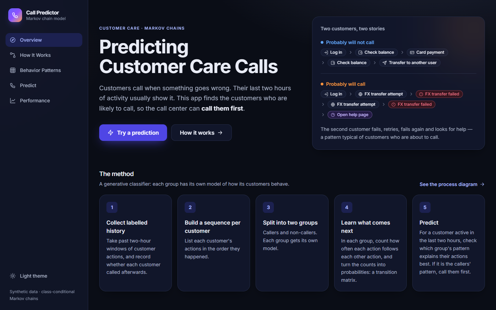
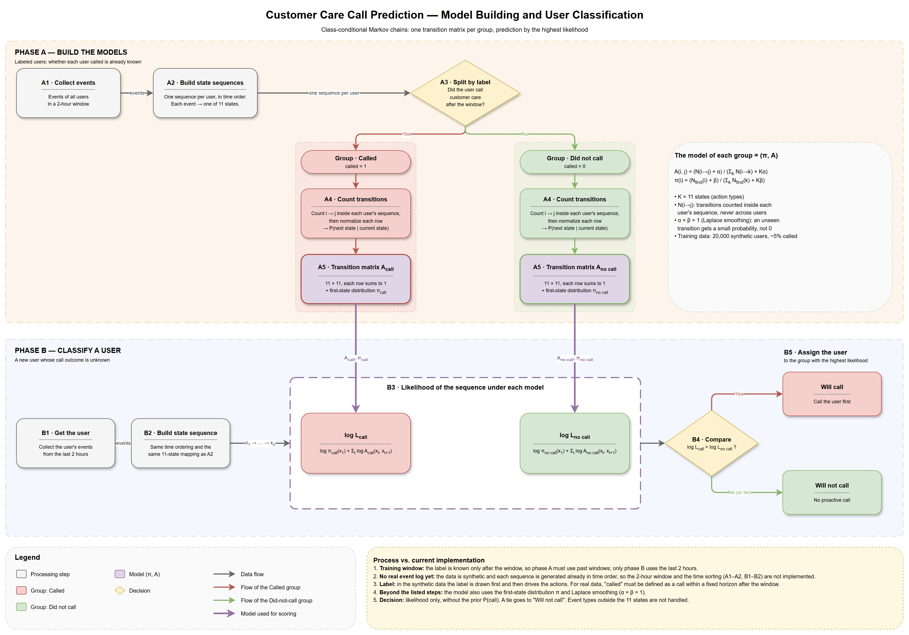
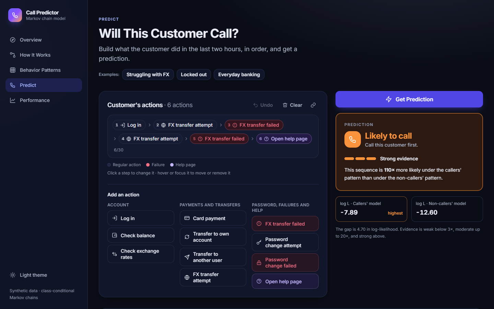
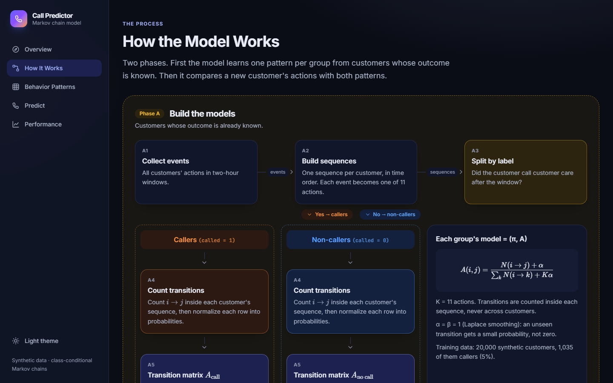
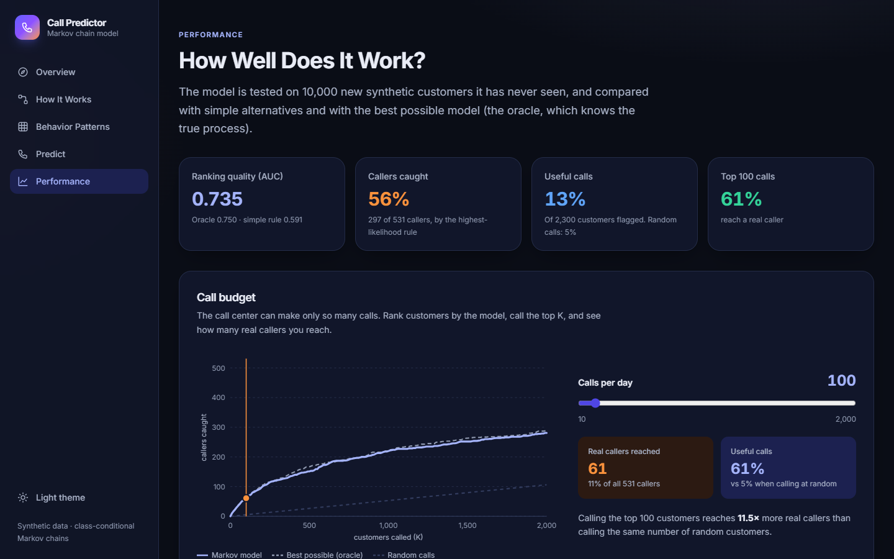

<div align="center">

# 📞 Customer Care Call Predictor

**Find the customers who are about to call customer care, and call them first.**


[The idea](#the-idea) · [How the model works](#how-the-model-works) · [The app](#the-app) · [Run it](#run-it) · [Results](#results)



</div>

## The idea

When something goes wrong, like a failed transfer or a locked password, customers often call customer care. Their actions in the last two hours usually show it.

This project learns how **callers** and **non-callers** move from one action to the next. It then uses this to spot customers who are likely to call, **before** they call.

## How the model works

<p align="center">
  <a href="docs/model-process-diagram/model-process.png">
    
  </a>
  <br>
  <sub>Click the diagram to see it full size · Editable source: <a href="docs/model-process-diagram/model-process.drawio"><code>model-process.drawio</code></a> (open it in <a href="https://app.diagrams.net">draw.io</a>)</sub>
</p>

The model has two phases. Each step matches a box in the diagram.

| | 🟧 **Phase A · Build the models**<br><sub>Customers whose outcome is already known</sub> | 🟦 **Phase B · Classify a customer**<br><sub>A new customer, outcome unknown</sub> |
|:-:|---|---|
| **1** | **Collect events:** all customers' actions in a 2-hour window | **Get the customer:** their actions from the last 2 hours |
| **2** | **Build sequences:** one per customer, in time order. Each action is one of 11 types | **Build the sequence:** the same way as in phase A |
| **3** | **Split by label:** did the customer call customer care after the window? | **Score it:** compute the sequence's likelihood under each group's model |
| **4** | **Count transitions:** in each group, count how often each action follows each other action | **Compare:** which of the two likelihoods is higher? |
| **5** | **Transition matrices:** turn the counts into probabilities, one matrix per group | **Assign:** the group with the higher likelihood wins. Callers → **call them first** |

> [!TIP]
> **Example:** Log in → FX transfer attempt → **FX transfer failed** → FX transfer attempt → **FX transfer failed** → Open help page
>
> This sequence is **110× more likely** under the callers' model, so the customer is **likely to call**.

<details>
<summary><b>The math in three formulas</b></summary>
<br>

**1. Transition matrix of group *c*.** $N_c(i \to j)$ counts how often action $j$ follows action $i$ in group $c$. There are $K = 11$ actions. Laplace smoothing ($\alpha = 1$) gives unseen transitions a small probability instead of zero.

$$A_c(i,j) = \frac{N_c(i \to j) + \alpha}{\sum_k N_c(i \to k) + K\alpha}$$

**2. Log-likelihood of a sequence** $x_1, \dots, x_n$. $\pi_c$ is the probability of the first action. Logarithms turn a long product of small numbers into a sum.

$$\log L_c = \log \pi_c(x_1) + \sum_{t=1}^{n-1} \log A_c(x_t, x_{t+1})$$

**3. Prediction.** The customer joins the group with the highest likelihood. A tie goes to non-callers.

$$\hat{c} = \arg\max_{c \in \lbrace \text{callers}, \text{non-callers} \rbrace} \log L_c$$

</details>

## The app

Five pages that tell the story in order:

| | Page | What you can do |
|:-:|---|---|
| 📘 | **Overview** | Read about the problem, see two example customers, the method and the math |
| 🗺️ | **How It Works** | Follow the two phases step by step: building the models and classifying a customer |
| 📊 | **Behavior Patterns** | Explore the two transition matrices and how they differ, cell by cell |
| 📞 | **Predict** | Build a customer's actions and get a prediction, with the strength of the evidence and the effect of each step |
| 📈 | **Performance** | See the results on 10,000 test customers and try different daily call budgets |

<table>
  <tr>
    <td width="50%"><p align="center"><b>Predict:</b> will this customer call?</p></td>
    <td width="50%"><p align="center"><b>Behavior Patterns:</b> where the two groups differ</p></td>
  </tr>
  <tr>
    <td width="50%"><p align="center"><b>How It Works:</b> the process, step by step</p></td>
    <td width="50%"><p align="center"><b>Performance:</b> how many callers you reach</p></td>
  </tr>
</table>

## Run it

### 1. What you need

| | Why |
|---|---|
| **Windows** 10 or 11 | For the one-click launcher |
| [**Python**](https://www.python.org/downloads/) 3.11 or newer | Runs the model and the server |
| [**Node.js**](https://nodejs.org) 22 LTS or newer | Builds the web pages. First run only |
| An internet connection | Downloads the packages. First run only |

### 2. Start the app

1. Get the project: `git clone https://github.com/DimaGitHub33/MarkovChain.git`, or use **Code → Download ZIP** on GitHub.
2. Double-click **`run_app.bat`**.
3. Your browser opens **http://localhost:8900** when the app is ready.

To stop the app, close the black window.

> [!NOTE]
> The **first run** takes a few minutes: the launcher creates a Python environment, installs the packages and builds the web pages. After that, the app starts in about 10 seconds.
> The launcher works from any folder, so you can also start it from a shortcut or a terminal.

### 3. If something goes wrong

| Message | What to do |
|---|---|
| *Python was not found* | Install Python 3.11 or newer, and select **Add python.exe to PATH** during setup. |
| *Node.js was not found* | Install Node.js 22 LTS, then run `run_app.bat` again. |
| *Port 8900 is already in use* | The app is probably already running. Open http://localhost:8900. |

## Results

Tested on 10,000 synthetic customers that the model has never seen. About 5% of them called.

| | Markov model | Calling at random |
|---|:-:|:-:|
| **Calls that reach a real caller** (top 100 customers) | **61%** | 5% |
| **Ranking quality** (AUC, best possible here is 0.750) | **0.735** | 0.5 |

## What's inside

```
backend/                     the model (markov_calls/) and the web server (api/), with tests
frontend/                    the web pages (React)
notebooks/                   the analysis, step by step: data → transition matrices → evaluation
docs/model-process-diagram/  the process diagram: draw.io source and PNG
docs/images/                 the screenshots on this page
scripts/                     helper scripts for building and testing
run_app.bat                  the one-click launcher
```

## For developers

<details>
<summary><b>Development mode, tests, API, notebooks and the diagram</b></summary>

### Scripts

| Command | What it does |
|---|---|
| `scripts\dev.bat` | Starts the server with auto-reload on :8000 and the web pages with hot reload on :5173 |
| `scripts\check.bat` | Runs all tests, the type check and the production build |
| `scripts\build_frontend.bat` | Rebuilds the web pages after you change `frontend/` |

Before the first `check.bat`, install the test tools:

```
.venv\Scripts\python -m pip install -r backend\requirements-dev.txt
```

### API

The server runs on the same port as the app. Interactive docs: **http://localhost:8900/api/docs**

| Method | Path | Returns |
|---|---|---|
| GET | `/api/actions` | The 11 actions and their categories |
| GET | `/api/model` | Group sizes and training settings |
| GET | `/api/patterns` | Transition matrices (learned and true) and transition counts |
| POST | `/api/predict` | `{"actions": ["login", ...]}` → prediction, likelihoods, evidence, step-by-step explanation |
| GET | `/api/performance` | All the results shown on the Performance page |

### Notebooks

The notebooks show the same process in detail. Run them in order: 1, 2, 3.

```
pip install -r notebooks\requirements.txt
```

### Editing the diagram

1. Open `docs/model-process-diagram/model-process.drawio` in [draw.io](https://app.diagrams.net) or the draw.io desktop app.
2. Export it as PNG (zoom 200%, white background) over `model-process.png` in the same folder.
3. Run `scripts\build_frontend.bat`. The README and the app's download links both use this folder.

### Technology

Python, NumPy, FastAPI and pytest on the server. React, TypeScript, Vite, Tailwind CSS and Vitest for the web pages. The charts are plain SVG.

</details>

## Good to know

- The data is **synthetic**: 20,000 training customers and 10,000 test customers, created with fixed random seeds. Every run gives the same results.
- The model looks only at the **order** of actions. Each step depends only on the action before it, not on timing.
- The yellow box at the bottom of the diagram lists what a production version would still need, such as a real event log and training on past windows.
