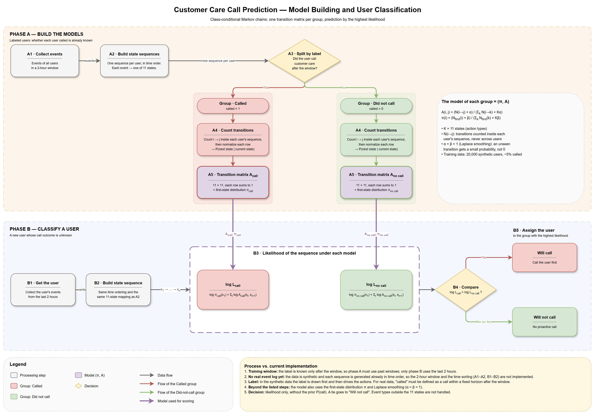

# MarkovChain — Predicting Customer Care Calls

This project finds customers who are likely to call customer care, so we can call them first.

It looks at what each customer did in the last two hours and asks: does this look more like a customer who calls, or like one who doesn't?



## How the model works

### Step 1 — Learn from past customers

1. Take customers whose outcome we already know: did they call customer care or not?
2. For each customer, list their actions in order. For example:
   `login → fx_transfer_attempt → fx_transfer_failed → open_help_page`
3. Put the customers into two groups: **callers** and **non-callers**.
4. In each group, count how often each action is followed by each other action.
5. Turn the counts into probabilities. This gives one **transition matrix** per group: a table that says what usually comes next after each action.

### Step 2 — Predict for a new customer

1. Take the customer's actions from the last two hours, in order.
2. Check how well this sequence fits the callers' matrix, and how well it fits the non-callers' matrix.
3. The group that fits better wins. If it is the callers' group, we call the customer first.

**Example:** a customer who tries a foreign currency transfer, fails, tries again, fails again and opens the help page fits the callers' pattern much better than the non-callers' pattern.

The data in this project is made up (synthetic), so we can test the idea before using real data.

## The app

The app has four pages:

| Page | What you can do there |
|------|-----------------------|
| **Overview** | Read what the project does and why |
| **How It Works** | See the diagram above, with zoom |
| **Behavior Patterns** | Compare the transition matrices of callers and non-callers |
| **Predict** | Build a sequence of actions, click **Get Prediction**, and see if the customer is likely to call — with a step-by-step explanation |

## How to run

```
pip install -r requirements.txt
streamlit run app/streamlit_app.py
```

The notebooks in `generative_classifier/` show the same process in detail. Run them in order: 1, 2, 3.
